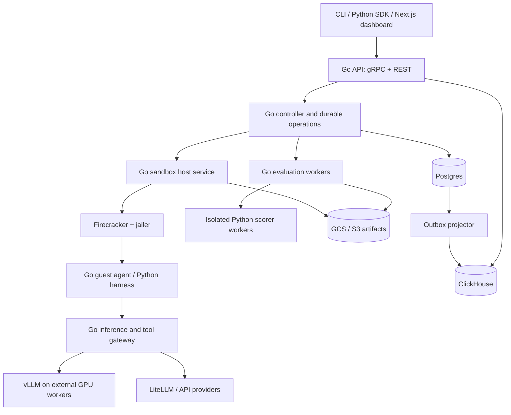

# Hypercall architecture

Status: Phase 0 marked ready and Phase 1A implementation authorized by the user.
This is the accepted implementation direction; unresolved numerical operating and
cloud choices remain bounded deferrals in PHASE_0.md.
Date: 2026-11-03. Working product name: Hypercall.

## Confirmed direction and delivery boundary

Hypercall will first serve its internal team, using Python agents and public or
synthetic benchmark inputs. Both self-hosted and API models are allowed under
that data policy. It will support whole-task model comparisons and continuations
from checkpoints, with separate reporting for the two types of experiment.

Development and validation will use cloud-service credits. The system will not
operate in production before investment. Production-quality code, isolation,
tests, observability, and reproducibility remain requirements from the start;
production availability commitments and live customer operations follow funding
and release qualification.

These are confirmed requirements. The topology and mechanisms below guide the
authorized local implementation; cloud deployment choices remain deferred. Python is confirmed, but a coding agent, task repository,
specific harness, credit provider/balance, and numerical limits have not been
selected. Track decisions in [PHASE_0.md](PHASE_0.md).

## 1. Product and architectural judgment

Hypercall runs agents in isolated Firecracker microVMs, creates branches from
recorded agent checkpoints, and measures which model and inference configuration
meets a quality requirement at the lowest cost and latency. Its outputs are a
trajectory comparison, a Pareto report, and a reproducible CI decision.

Reusing these projects is a sound foundation. The integration should be a
selective consolidation into one Hypercall codebase with explicit interfaces.
Each upstream has its own resource model, lifecycle, storage assumptions, and
deployment machinery. Importing all their control planes would create competing
owners of the same sandbox. Hypercall must own the product semantics and adapt
selected upstream implementations to them.

The central engineering problem is a consistent checkpoint across VM state,
agent state, event history, inference routing, and tool effects. A working VM
clone alone does not establish a valid model comparison. Production readiness
must be demonstrated by failure testing, isolation testing, and reproducible
measurements at each build stage.

## 2. Scope and guarantees

The intended product supports:

- Task and inference matrix definitions in versioned YAML.
- Durable scheduling, suspend/resume, checkpointing, and branch lineage.
- Python agents and harnesses; Go services and CLI; a Next.js dashboard.
- Self-hosted inference through vLLM and API inference through LiteLLM.
- Deterministic assertions, isolated Python scorers, and recorded LLM judges.
- Quality, cost, latency, and reliability reports with explicit measurement scope.

The phrase "fork from any step" means any retained, committed checkpoint at a
supported harness step boundary. An unrecorded historical instruction cannot be
recovered. Re-executing from an earlier checkpoint is replay, which must be
labeled separately and may be nondeterministic.

The phrase "exact divergence step" means the first observed difference at the
instrumentation granularity, according to a declared comparator. It is evidence
about trajectories, not proof that a model change caused the eventual failure.
Uninstrumented agents can use sandbox APIs but cannot receive step-level claims.

The initial users are internal operators. Authentication, tenant-scoped resources,
and isolation are built into the contracts; customer onboarding, billing, public
signup, and externally committed SLOs are outside the pre-investment release.
CLI and Python SDK access provide the first complete workflow; the planned Next.js
dashboard presents the same operations and reports once the core is verified.

GPU model servers run outside the microVM. Their weights, KV caches, scheduler
state, and remote provider state are outside a Firecracker checkpoint. Hypercall
does not promise bitwise deterministic generation or rollback of external systems.

## 3. Upstream grounding and provenance

Four repositories are inputs: the two E2B repositories form one sandbox stack.
The following are inspected source revisions, not imported code or a compatibility
certification. Before copying code, create an explicit import record and run the
relevant upstream tests against the selected dependency versions.

| Source | Inspected commit | Grounding and intended reuse |
| --- | --- | --- |
| [google/ax](https://github.com/google/ax/tree/1dd2e923a351ccb369266f8145c8b218cce96c76) | `1dd2e923a351ccb369266f8145c8b218cce96c76` | Go server, resource schemas, reconciliation, workspace setup, suspend/resume, CLI patterns. Start with `DESIGN.md`, `docs/manifests.md`, `internal/server`, `internal/controller`, `pkg/apis`, and `runner`. |
| [e2b-dev/runtime](https://github.com/e2b-dev/runtime/tree/0446bafb471fe3a12ec961e35f58df36e9bfbbb9), formerly `e2b-dev/infra` | `0446bafb471fe3a12ec961e35f58df36e9bfbbb9` | Firecracker lifecycle, template building, snapshot storage, restore, fork, process/filesystem operations. Start with `docs/ARCHITECTURE.md`, `packages/orchestrator`, `packages/envd`, `packages/shared`, and `packages/api/internal/handlers/sandbox_fork.go`. |
| [e2b-dev/E2B](https://github.com/e2b-dev/E2B/tree/fd72526782d379cbb8ee71c3297bfb2ce3be82ce) | `fd72526782d379cbb8ee71c3297bfb2ce3be82ce` | Python SDK behavior, sync/async lifecycle, commands, files, cancellation, and error handling. Start with `packages/python-sdk/e2b`; adapt transports and identity to Hypercall. |
| [promptfoo/promptfoo](https://github.com/promptfoo/promptfoo/tree/f2b012e3c9f9ffb7b23edf4cf88ea63febf72f5a) | `f2b012e3c9f9ffb7b23edf4cf88ea63febf72f5a` | Evaluation semantics and test cases. Start with `src/evaluator.ts`, `src/assertions`, `src/types`, `src/util/config`, and corresponding `test` fixtures; port the selected behavior to Go. |

### Findings that change the integration plan

- The requested E2B infrastructure URL currently redirects to `e2b-dev/runtime`.
  Track the requested name and canonical repository in provenance records.
- Inspected AX reconciles against Agent Substrate and stores resources in
  Postgres. Replacing Substrate requires changes in server status derivation as
  well as controller calls. AX's documented API includes Task, Workspace, and
  Model; Gateway, durable trajectories, branching, and a product event log must
  be verified individually or implemented by Hypercall. They are not assumed
  to be available just because they were in the initial product description.
- Inspected E2B already implements live sandbox checkpoint/fork, including
  per-child failures. Reuse that path as the runtime reference. Its full backend
  also depends on Redis and other infrastructure; extraction is real engineering
  work, not a drop-in replacement for AX's execution client.
- Inspected E2B documents a network-accessible `envd` service. Hypercall's required
  host-to-guest gRPC over vsock is an explicit adaptation to validate; it is not
  treated as an already verified upstream transport.
- SDK and server revisions need contract testing together. Even fork limits in
  inspected SDK documentation and server code differ; upstream HEADs are not a
  tested release pair.
- Promptfoo contains much more than this product needs. A TypeScript-to-Go port
  must define its compatibility subset and test semantic differences explicitly.

### Import policy

For every copied or translated component, maintain `third_party/upstreams.yaml`
with repository URL, exact commit, source paths, destination paths, import date,
license files, modifications, translated fixtures, and local verification.
Preserve source copyright headers, applicable LICENSE/NOTICE files, and notices
for modified files. Maintain distribution attribution in
`THIRD_PARTY_NOTICES.md`; include notices in shipped images, wheels, binaries'
distribution bundles, and source archives as applicable.

The inspected AX and E2B runtime root licenses are Apache-2.0. E2B's root license
is Apache-2.0, while its inspected Python SDK package has an MIT license.
Promptfoo's inspected root license is MIT, and some nested components carry
different notices. Inspect the exact files and dependencies being reused rather
than applying a repository badge to every file. The existing Hypercall BSD-3-Clause
license remains in place; imported material retains its applicable terms.

Use normal packages in their destination domains, with provenance mapping back
to upstream. Keep imports small enough to review and updates explicit. Do not
automatically sync upstream changes. No upstream code is copied in this proposal.

## 4. System boundaries



Start with a modular Go control-plane binary and worker roles from the same
codebase. The privileged host service, guest agent, Python execution environments,
and external inference servers are separate processes and trust boundaries.
Split additional services only when scaling or security requires it.

| Component | Owns | Boundary |
| --- | --- | --- |
| API and CLI | Auth, schema validation, admission, operation requests, reporting | Hypercall protobuf API; generated REST mapping |
| Controller | Desired state, scheduling, durable leases, budgets, run/branch transitions | Postgres transactions and sandbox backend contract |
| Sandbox host | Actual VM state, resource allocation, networking, snapshot mechanics, cleanup | Authenticated internal gRPC; Firecracker Unix socket |
| Guest agent | Processes, files, harness lifecycle, checkpoint barrier | Host connection over vsock; no public guest control port |
| Python SDK/harness | Agent execution, stable step events, checkpoint participation | Generated Python protobuf types and gRPC clients |
| Inference/tool gateway | Branch-specific routing, call ledger, policy, metering, replay fixtures | gRPC control/events; HTTPS provider-compatible inference endpoints |
| Evaluation workers | Assertion execution, scoring coordination, aggregation, reports | Versioned Go/Python scorer protobuf contract |

AX and E2B must not both schedule or own authoritative sandbox lifecycle records.
The AX-derived controller calls a Hypercall `SandboxBackend` implemented using
selected E2B runtime code. Hypercall owns allocation and durable lifecycle intent;
the host reports observed runtime state. Do not retain the entire E2B public API,
tenant system, scheduler, or Redis-backed running-sandbox registry alongside it.
Select and test the necessary runtime dependencies during phase 1; if extraction
requires a temporary Redis cache, document it and keep it non-authoritative.

vLLM and LiteLLM remain independently versioned dependencies. LiteLLM is Python
software in the serving path, not a library to port into the Go control plane.
The Next.js application uses the REST API; it has no direct database access.

### Deployment before and after investment

One codebase supports two deployment profiles. The development profile must use
the same sandbox, checkpoint, event, and evaluation contracts as the production
profile so that measured correctness transfers between environments.

| Concern | Credit-funded development/staging | Production after investment |
| --- | --- | --- |
| Users | Internal operators and controlled experiments | Qualified internal production use, then customer access |
| Control plane | One Go API/controller instance; worker roles can share its deployment | Replicated services with measured capacity and fenced ownership |
| Sandbox hosts | Small Linux KVM pool; begin with one host, use an additional temporary host for cross-host/failure tests | Dedicated host pools with capacity management, rollout and recovery procedures |
| Postgres | One development instance with migration and backup/restore exercises | Availability and recovery configuration chosen against approved RPO/RTO |
| Artifacts | GCS with bounded retention; local host cache is disposable | Retention, encryption, recovery and deletion qualified at the supported scale |
| ClickHouse | Introduce in the evaluation stage; correctness remains independent of analytics | Scaled projection with lag monitoring and rebuild procedures |
| Inference | Deterministic fixtures first; credit-covered GPU/API experiments scheduled on demand | Qualified GPU/API capacity with routing, budget and availability policies |
| Deployment automation | Reproducible host bootstrap and service configuration; test Helm/Terraform in staging as developed | Reviewed infrastructure plans, staged upgrades, rollback and incident operations |
| Evidence | Test results and measured experiment reports; no production SLA | Approved SLOs and release evidence within a stated operating envelope |

The one-host starting point is a cost-control proposal, not a production topology
or evidence of cross-host resilience. Shared development hosts remain separated
by process privileges, guest isolation, and restricted network paths. Tenant
code never receives control-plane credentials or privileged host access.

### Funding and resource admission

Track a development resource allowance per provider: available credit, eligible
services, expiry, region restrictions, spending limits, and measured usage. Cloud
compute credit does not automatically imply access to funded GPUs or model APIs;
verify each intended service against the actual account/program before use.

The proposed admission policy reserves an estimated allowance before a run or
fan-out, accounts for all branches and attempts, and stops admitting work when
the remaining allowance is insufficient or unknown. Add maximum run duration,
VM lifetime, experiment concurrency, checkpoint retention, and idle teardown.
Provider billing can lag and retained storage can incur charges after compute
stops, so resource admission alone is not a guarantee of zero cash charges.
The user must choose the overage policy and caps before provisioning.

Until credit coverage and limits are established, use local development,
contract tests, deterministic inference fixtures, and already-authorized test
infrastructure. No resources or paid calls are authorized by this architecture.

## 5. Domain model and public contracts

All resources carry tenant/project identity, schema version, immutable IDs,
timestamps, and revision numbers. Names are scoped to a tenant and project.

| Resource | Meaning |
| --- | --- |
| Task | Immutable experiment specification: agent, workspace, dataset, matrix, evaluation, budgets |
| Workspace | Versioned inputs, pinned repositories, files, and writable-disk policy |
| Template | Immutable rootfs, guest kernel/agent, harness image, and verified ready snapshot |
| ModelConfig | Immutable effective model, tokenizer, quantization, serving, and sampling configuration |
| Gateway | Versioned routing and egress policy; holds secret references, not secret values |
| Run | One execution of a resolved Task revision with repetition/seed and provenance |
| Branch | One continuation with a parent checkpoint and selected ModelConfig; forms a DAG |
| Step | Harness-defined committed transition with ordered inference/tool/observation events |
| Checkpoint | Durable VM artifact manifest plus event position, barrier state, and compatibility metadata |
| Operation | Durable, idempotent asynchronous create/checkpoint/fork/cancel/delete request |
| Evaluation / Report | Versioned scores, errors, measurement scope, confidence data, and CI result |

Forking always creates new branch, sandbox, execution, and credential identities.
A branch's selected configuration cannot change after it starts; another change
creates a new branch. Mutable names resolve to immutable revisions at admission.

Protobuf packages under `proto/hypercall/v1/` define public APIs and shared
Go/Python contracts. Internal host and scorer services have separate packages.
Generate Go and Python clients and REST/OpenAPI from these definitions. Check
breaking changes in CI, reserve removed field numbers, and avoid leaking upstream
API types into public Hypercall contracts.

Minimum service groups: Task/Workspace/Model/Gateway management, Run and Branch
operations, Sandbox operations, ordered event append/watch, and Evaluation/Report
retrieval. Long operations return an Operation ID. Mutations use scoped idempotency
keys; pagination uses stable cursors. SDK errors preserve canonical status codes,
retryability, and operation identity.

All Hypercall-owned Go/Python RPCs use protobuf/gRPC, including scorer calls and
harness events. Provider inference traffic may use HTTPS with provider-compatible
payloads; stream cancellation and backpressure must survive the guest/host bridge.
The external Python SDK reaches the API, which authorizes command/file streams
and routes them through the host. It never receives direct access to the vsock
device or host control credentials.

YAML is a declarative input format compiled into validated protobuf resources.
Reject unknown fields and unsupported matrix combinations. Resolve template,
agent code, dataset, scorer, prompt, and model artifacts to immutable digests.
Do not execute arbitrary template expressions while parsing configuration.

## 6. Checkpoint and fork protocol

A supported step boundary occurs after an inference/tool action and its
observations are durably committed, before the next action is dispatched. Every
inference/tool request has a branch-scoped call ID and recorded completion state.
Subevents retain ordering within a step; step numbers alone are insufficient.

1. The controller reserves the operation and capacity under a lease with a
   fencing epoch. It requests a harness barrier at the selected step.
2. The harness stops new actions, joins registered work, and flushes events.
   The gateway denies new calls for that branch, drains active streams, and
   verifies no unresolved tool effects. A step containing unresolved work is
   not checkpointable. Background work must be registered or explicitly excluded
   from semantic checkpoint guarantees.
3. The guest records a checkpoint marker with the final acknowledged event
   sequence and waits at a resume gate. Flush files and quiesce filesystem writes;
   the host pauses vCPUs and captures memory, VM state, and a consistent disk view.
   Device-level consistency alone does not establish an agent step boundary.
4. Store artifacts in a staging namespace, verify hashes and sizes, then publish
   an immutable manifest. A Postgres transaction marks the checkpoint ready only
   after all required objects are available. Partial uploads remain unusable and
   are collected after a retention window.
5. Create one durable child allocation per matrix configuration and repetition.
   Restore each into private writable storage with compatible host capabilities.
   A fork request records each child's success/failure and can resume partially
   completed work without creating duplicate children.
6. Establish a fresh host/guest session. Rebind branch identity, virtual network,
   call namespace, gateway mapping, credentials, clocks, and RNG policy. Reset or
   reconnect inherited transports. The harness clears clients' cached routing
   state and acknowledges its configuration hash before the next model call.
7. Release each child's resume gate only after the host lease, branch identity,
   network policy, and routing checks pass. Release the parent according to the
   task's explicit continue/pause/stop policy. Parent continuation remains behind
   the barrier until its own session is valid again.

The stable model endpoint is selected at runtime through a branch-aware gateway.
Changing an environment variable after restoring a Python process is insufficient
when clients cached their model or endpoint before the snapshot. Model-specific
clients must support the harness resume hook or be declared unsupported.

The checkpoint manifest includes template/rootfs digest, kernel, guest agent and
harness versions, Firecracker version and snapshot format, CPU template/architecture,
vCPU/RAM/device configuration, disk layer digests, memory/state digests, parent
checkpoint, committed event position, and protocol version. Verify compatibility
before placement. Do not accept arbitrary tenant-provided VM memory/state files
as trusted restore artifacts.

Begin with a fully materialized snapshot and private child disk baseline.
Qualify E2B's lazy restore and incremental memory/disk paths against that baseline
before enabling them. Preserve immutable bases and reference counts; never mutate
a snapshot used by another child. Benchmark actual memory, disk, concurrency,
and storage-network conditions instead of assuming constant-time forks.

Firecracker's snapshot documentation explicitly separates disks from VM state,
describes reconnect requirements, and treats snapshot artifacts as trusted input.
These constraints inform the protocol above. [Firecracker snapshot documentation](https://github.com/firecracker-microvm/firecracker/blob/main/docs/snapshotting/snapshot-support.md)

## 7. External effects, replay, and divergence

All comparable runs declare a tool policy:

- **Fixture mode:** versioned tool responses and branch-private services/data.
  This is the default for CI comparisons.
- **Controlled live mode:** allowlisted services with explicit isolation or
  idempotency support. Record versions, requests, results, and effect IDs.
- **Unrestricted live mode:** exploratory use with visibly weaker reproducibility;
  no claim of exact rollback or controlled causality.

The initial accepted data scope is public/synthetic. Private repositories,
confidential prompts, and tenant data require a separately agreed access and
provider-egress policy before entering either benchmark mode.

A VM snapshot cannot roll back a payment, database write, clock, or website.
Do not replay a mutating tool request automatically after an ambiguous timeout.
Record it as unresolved until the downstream service can confirm its outcome.
On restore, copied credentials or network sessions are revoked/replaced at the
gateway; inherited identity cannot authorize a child. Provider secrets stay outside
guest memory. Shared memory snapshots still contain private agent data and must
remain within their tenant security boundary.

Persist raw model output, tool calls and arguments, observations, selected state
digests, errors, and timing. For siblings with a common checkpoint, compute the
first difference under versioned comparators: raw bytes, normalized content,
tool behavior, and evaluated outcome. Keep these results separate. If traces
stop or instrumentation differs, report divergence as unknown or bounded rather
than inventing a step. After paths diverge, align by causal event references and
tool intent where possible; equal ordinal step numbers may describe different work.

## 8. Inference matrix and evaluation

A matrix cell identifies provider/deployment, model and weight revision,
tokenizer and chat template, quantization method/artifact/calibration identity,
compute/KV-cache dtype, serving engine/version, GPU type/count, parallelism,
context limits, tool format, and sampling parameters. Unsupported combinations
fail admission. API providers with undisclosed revisions are marked accordingly.

Keep the agent and its tool adapter fixed within a comparison unless the
experiment explicitly varies them. Record any provider-specific prompt or tool
conversion. Gateway policy prevents unrecorded fallbacks, automatic routing to
another model, and hidden retries. Record the deployment that actually served
each request and meter every attempt, including canceled or failed calls.
LiteLLM supports routing/retry behavior, so benchmark deployments must configure
those features deliberately. [LiteLLM routing documentation](https://docs.litellm.ai/docs/proxy/load_balancing)

Comparisons have two distinct scopes:

- **Continuation experiment:** a common prefix produced by a declared reference
  model; only the suffix varies. Conclusions concern continuation from that state.
- **Whole-task experiment:** each candidate runs from the same initial workspace
  and fixtures. Use this to claim that a configuration works for the full task.

Use repetitions across tasks and declared seeds. Separate cold/warm cache and
cold/warm deployment experiments, randomize or balance execution order, and
record competing load. A seed is metadata, not a cross-provider determinism
guarantee. Report sample counts and uncertainty; a single success cannot establish
reliability. Define quality thresholds, minimum samples, and the CI decision rule
before execution. Validate selected winners on a held-out workload.

Port Promptfoo behavior in a documented subset: matrix expansion, case variables,
exact/contains/JSON/schema/numeric assertions, assertion weights and thresholds,
grader results, and CI aggregation. Use immutable upstream fixtures as a
differential test oracle, including negation, missing values, Unicode, error
handling, and aggregation. JavaScript regex and templating semantics differ from
Go; declare supported behavior and reject incompatible configurations. Arbitrary
JavaScript assertions, provider plugins, and full Promptfoo YAML compatibility
are outside the initial contract.

Go handles core assertions and scheduling. Custom Python scorers and LLM judges
run in isolated workers with deadlines, memory/CPU limits, restricted egress,
and versioned input/output contracts. Pin scorer code, rubric, judge model, and
parameters. Treat grader timeout/error as an evaluation error, never a passing
score. Record judge cost separately and protect judge instructions from untrusted
agent output. Validate judge behavior against human-reviewed examples.

Reports include success rate and score distributions, failure categories,
end-to-end wall time, queue/startup/restore time, inference latency and time to
first token, tool time, token usage, retries, sandbox resources, and scoring cost.
Use timestamped price records and distinguish measured billing from estimates.
For self-hosting, show GPU allocation/idle time, storage, and transfer assumptions;
token count alone is not serving cost. Prices are inputs to a measurement, not
hardcoded architectural facts.

Show shared-prefix cost once at experiment level and continuation cost per child;
show whole-task cost separately. Pareto analysis maximizes qualified quality and
minimizes cost/latency within an identical workload and cache policy. Preserve
errors and missing cells in the denominator policy. An incomplete experiment
cannot pass CI silently. CI exits nonzero on quality regression, budget breach,
or execution/evaluation error, with distinct machine-readable reasons.

## 9. Persistence and failure recovery

| Store | Authoritative data | Recovery rule |
| --- | --- | --- |
| Postgres | Resource revisions, operations, assignments/epochs, branch DAG, checkpoint manifests, ordered event metadata, call ledger, final evaluations, outbox | Versioned migrations, backups/PITR, restore drills; transactional state and event updates |
| GCS initially; S3 adapter | Memory/state/disk artifacts, transcripts, datasets, reports, large event payloads | Immutable objects, checksums, encryption, committed manifests, reference-aware retention |
| ClickHouse | Derived trajectory and measurement analytics | Rebuild from durable events/artifacts; no lifecycle decisions depend on it |
| Host disk/cache | Downloaded snapshot layers, temporary uploads, runtime disks | Reconstruct from committed artifacts; unpublished host state is not durable |

Use a Postgres transactional outbox and leased job claims initially. Delivery is
at least once; consumers deduplicate by event/operation ID. Append events with a
per-branch sequence and unique call identity. Reject appends from stale execution
epochs. Finalization records the last committed event so a truncated trace cannot
look complete. Watch clients resume from durable cursors.

State transitions use optimistic revisions and fenced leases. Cancellation and
timeouts are persisted intents that reconcile to termination and cleanup. The
host fences execution locally when its lease expires; the controller does not
issue an overlapping active assignment until termination or lease expiry is
established. Gateway access also checks the current execution epoch.

| Failure | Required behavior |
| --- | --- |
| Controller restart / duplicate RPC | Reclaim durable operations and return existing results for repeated idempotency keys |
| Host failure | Mark execution interrupted; resume from last committed checkpoint as a new attempt, preserving lost-work accounting |
| Network partition | Fence old host and reject stale calls/events; expose uncertainty until ownership is established |
| Snapshot upload or database commit fails | Checkpoint stays unready; retry safely; collect orphan artifacts later |
| Some fork children fail | Preserve each cell result; retry only eligible failed allocations with bounded policy |
| Inference/tool timeout with unknown outcome | Record ambiguity and cost uncertainty; do not assume safe re-execution |
| ClickHouse unavailable | Continue durable execution; reports show analytics lag and use authoritative completion records |
| Quota/budget exhaustion | Stop admitting work and request bounded cancellation; report in-flight overshoot separately |

Checkpoint artifacts and database backups have coordinated retention. Garbage
collection verifies references and active leases before deleting layers. Deletion
of a parent branch does not invalidate retained children. Define regional RPO/RTO
and prove recovery against workload targets before production release.

## 10. Security, deployment, and observability

Tenant IDs, access checks, database constraints, artifact scope, and identity
boundaries exist from phase 1. General customer onboarding and sophisticated
multi-tenant scheduling arrive later. Use OIDC/API keys at ingress, authenticated
service identities and mTLS internally, and short-lived branch credentials.
Authorization derives tenant identity from authentication, never request fields.

Use Firecracker plus jailer, host/guest patching, seccomp, cgroups v2, network
namespaces, restricted host mounts, and explicit CPU/RAM/disk/PID/time limits.
Treat vsock as transport rather than authentication: bind sessions to the host's
allocation and current epoch. Deny guest access to cloud metadata, internal
control endpoints, and host networks. Egress is policy controlled; the gateway
enforces inference and registered-tool access. Revalidate secrets and RNG/identity
handling on every clone. Tenant-provided Dockerfile builds run on isolated build
workers, without production host credentials, with provenance and artifact scans.

The production deployment target runs the control plane, dashboard, evaluators,
and collectors in Kubernetes with Helm. Its configuration is exercised in staging
before release. Provision dedicated Linux x86_64 GCE host pools with nested virtualization,
KVM, and local snapshot cache using Terraform. Run the privileged sandbox host
as a managed host service initially, outside ordinary workload pods. Qualify the
specific GCE machine family, kernel, CPU template, and Firecracker combination;
provider support for nested virtualization is not a performance guarantee.
macOS development uses contract tests and remote Linux integration hosts.
[GCE nested virtualization documentation](https://docs.cloud.google.com/compute/docs/instances/nested-virtualization/overview)

Connect RunPod or Modal GPU workers over authenticated encrypted endpoints;
record their region, hardware, image, and deployment revision. Treat cross-cloud
network latency, data transfer, private-data policy, and worker availability as
measurement/deployment inputs. GCS is the initial artifact backend; qualify S3
through the same storage contract. A general GPU scheduler and multi-region
failover are later milestones, not hidden prerequisites for the first release.

Emit OpenTelemetry traces across API, scheduling, restore, harness calls,
inference, and scoring. Export bounded-cardinality metrics to Prometheus and
dashboards/alerts to Grafana. Track queue depth, lease expiry, barrier failures,
snapshot publication/restore latency, host pressure, branch failures, gateway
retries, spend, evaluator errors, and analytics lag. Keep run/branch IDs in logs
and traces rather than unbounded Prometheus labels. Record privileged actions
in an audit log. Redact secrets and apply tenant retention policy to prompts,
outputs, traces, and memory snapshots.

Production SLOs must be approved from measured capacity and recovery data: API availability,
scheduling delay, checkpoint/restore success, supported fan-out, event durability,
and reporting delay. Do not declare latency or availability guarantees without
a workload envelope and recovery evidence.

## 11. Proposed repository layout

```text
cmd/                       Go API, CLI, host, guest, and worker entrypoints
internal/controlplane/     AX-derived resources, controller, operations, storage
internal/sandbox/          E2B-derived runtime, templates, snapshots, host backend
internal/guest/            E2B-derived guest operations and vsock adaptation
internal/gateway/          Branch routing, inference/tool ledger, policy, metering
internal/eval/             Promptfoo-derived Go assertions and aggregation
proto/hypercall/           Versioned public, host, harness, and scorer contracts
sdk/python/               E2B-grounded Hypercall client and agent harness
python/                   Scorers, judges, quantization and benchmark tooling
web/                      Next.js dashboard
deploy/helm/               Kubernetes packaging
deploy/terraform/          GCP host pools and supporting infrastructure
third_party/              Upstream import ledger and applicable license files
test/                     Contract, conformance, integration, fault, security tests
docs/                     Architecture, ADRs, operating and recovery procedures
```

Pin Go/Python/Node toolchains, dependencies, protoc/generators, Firecracker/jailer,
kernel, and images. Commit lockfiles, versioned database migrations, protobuf
compatibility checks, reproducible generation/build commands, and release SBOMs.
Publish independently identifiable server, host/guest, SDK, and schema versions
with a tested compatibility matrix and rollback procedure.

## 12. Build order and acceptance gates

See [DEVELOPMENT_PHASES.md](DEVELOPMENT_PHASES.md) for stage deliverables,
dependencies, acceptance scenarios, and completion evidence.

Every phase includes tests, telemetry, provenance, and operating instructions.
The stages are increments toward production, not throwaway implementations.
Before investment, execute these stages in development/staging within the
verified credit allowance. Production operation requires investment plus the
release qualification gate; completing code does not itself authorize launch.

| Phase | Deliverable | Evidence required before advancing |
| --- | --- | --- |
| 0. Architecture review | This document; confirmed scope and unresolved decisions | User review before code imports, scaffolding, or implementation |
| 1. Sandbox foundation | Selected E2B runtime/SDK code; Linux host/guest bridge; template build; snapshot/restore/fork backend | Contract tests; real KVM boot/commands/files; memory and disk continuity; sibling write isolation; clone identity/transport renewal; partial-fork recovery; host crash and corrupt/missing artifact tests; measured resource envelope |
| 2. Control plane | AX-derived server/controller/CLI against the sandbox backend; Postgres events; Python step barriers and lineage | End-to-end checkpoint and model-routing fixture; duplicate/cancel/lease/partition tests; stale-epoch rejection; backup/restore drill; complete retained event history |
| 3. Evaluation | Promptfoo-derived Go subset; isolated Python scorers; reports and CI gates | Differential fixtures at pinned revisions; scorer timeout/error tests; statistical aggregation and cost accounting checks; incomplete-run CI failure |
| 4. Inference and product operations | vLLM/LiteLLM matrix, quantization benchmarks, dashboard, Helm/Terraform, production tenant workflows | Whole-task and continuation experiments; measured price/latency provenance; tenant isolation and quota tests; upgrade/rollback drills; load/soak tests and approved SLOs |

In phases 1/2, a deterministic inference stub validates routing and checkpoint
semantics without making model-performance claims. Real matrix benchmarking is
phase 4. Tenant boundaries and safe execution remain phase-1 requirements even
though customer-facing multi-tenancy features come later.

## 13. Decisions for review

Confirmed direction is recorded at the start of this document. The following
implementation defaults remain proposals:

1. Consolidate selected code into Hypercall with one authoritative controller and
   storage model, replacing AX's Substrate dependency through an explicit backend.
2. Make a cooperative Python harness the supported path for semantic checkpoints;
   expose weaker sandbox-only behavior explicitly for other agents.
3. Use retained step checkpoints and fixture-mode tools for comparable CI runs.
4. Begin on one GCP region with Linux x86_64 host pools, GCS, Postgres, and a
   ClickHouse projection; keep inference workers external to the sandbox hosts.
5. Port a tested Promptfoo subset to Go, with custom grading over Python gRPC,
   and publish the compatibility limits.
6. Prove restore correctness with a fully materialized baseline before enabling
   lazy/incremental optimizations or committing performance targets.

Review must establish the first Python agent harness/tool workload, required
checkpoint retention, expected concurrency/fan-out, GPU/API provider and residency
choices, and acceptable reliability/cost/latency thresholds. Credit accounts,
eligible services, expiry, numerical spending caps, and cash-overage policy remain
unresolved. The target capability to demonstrate before investment also needs
agreement. These inputs determine test capacity and the delivery scope; no guessed
numerical targets or credit awards are binding.

The user subsequently marked Phase 0 ready and requested implementation.
[PHASE_0.md](PHASE_0.md) records the bounded deferrals and authorization;
[PHASE_1.md](PHASE_1.md) narrows the current work. This authorization does not
permit cloud spending or production operation.

## 14. Primary references

- [AX design at the inspected commit](https://github.com/google/ax/blob/1dd2e923a351ccb369266f8145c8b218cce96c76/DESIGN.md) and [controller implementation](https://github.com/google/ax/blob/1dd2e923a351ccb369266f8145c8b218cce96c76/internal/controller/reconciler.go).
- [E2B runtime architecture](https://github.com/e2b-dev/runtime/blob/0446bafb471fe3a12ec961e35f58df36e9bfbbb9/docs/ARCHITECTURE.md) and [fork handler](https://github.com/e2b-dev/runtime/blob/0446bafb471fe3a12ec961e35f58df36e9bfbbb9/packages/api/internal/handlers/sandbox_fork.go).
- [E2B Python sandbox implementation](https://github.com/e2b-dev/E2B/blob/fd72526782d379cbb8ee71c3297bfb2ce3be82ce/packages/python-sdk/e2b/sandbox_sync/main.py) and [package license](https://github.com/e2b-dev/E2B/blob/fd72526782d379cbb8ee71c3297bfb2ce3be82ce/packages/python-sdk/LICENSE).
- [Promptfoo evaluator](https://github.com/promptfoo/promptfoo/blob/f2b012e3c9f9ffb7b23edf4cf88ea63febf72f5a/src/evaluator.ts), [assertions](https://github.com/promptfoo/promptfoo/blob/f2b012e3c9f9ffb7b23edf4cf88ea63febf72f5a/src/assertions/index.ts), and [root license](https://github.com/promptfoo/promptfoo/blob/f2b012e3c9f9ffb7b23edf4cf88ea63febf72f5a/LICENSE).

Source facts above describe the inspected revisions. Proposed Hypercall contracts,
protocols, deployment choices, and guarantees are design decisions, not claims
that the upstream projects already implement them.
